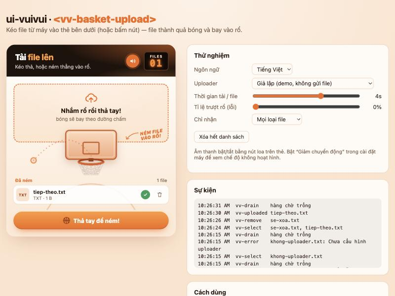
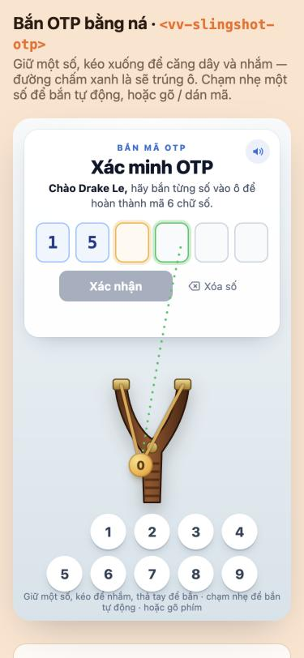
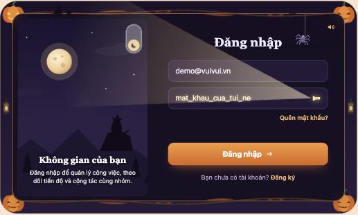

# ui-vuivui



Thư viện **Web Component vui vẻ** cho các thao tác thường gặp — upload file, in, đăng nhập, nhập OTP, captcha… Mỗi thành phần làm **việc thật**, chỉ có lớp "da" là trò chơi. Dùng được ở mọi web (HTML thuần, React, Vue…), không phụ thuộc thư viện ngoài.

| Thành phần | Trạng thái |
|---|---|
| `<vv-basket-upload>` — ném file vào rổ để upload | ✅ v0.1 |
| `<vv-slingshot-otp>` — bắn từng số OTP vào ô bằng ná cao su | ✅ v0.1 |
| `<vv-halloween-login>` — đăng nhập ngày ↔ đêm Halloween, đèn pin soi mật khẩu | ✅ v0.1 |
| Ném đề vào máy in (`<vv-print>`) | dự kiến |
| Captcha vui (vỏ trò chơi bọc captcha thật: Cap / ALTCHA / Turnstile) | dự kiến |

**Demo trực tuyến:** https://ui-vuivui.bangluutru.workers.dev

## Chạy thử

```bash
npm install
npm run dev      # trang demo: http://localhost:5180
npm test         # test phần lõi
npm run build    # thư viện → dist/
npm run deploy   # build trang demo + đưa lên Cloudflare Workers (cần `wrangler login`)
```

## Dùng trong app khác

```bash
npm i ../ui-vuivui                 # từ thư mục bên cạnh
# hoặc, khi đã có repo GitHub:
npm i github:bangluutru/ui-vuivui
```

Gói trỏ thẳng vào mã nguồn ES module (`src/index.js`), không cần build, chạy được với Vite/webpack/esbuild.

## `<vv-basket-upload>`

Kéo file vào thẻ → hiện đường chấm từ con trỏ tới rổ → thả tay, file thành quả bóng bay lên vành.
Trong lúc upload, bóng **lăn quanh vành** (lắng dần theo tiến trình). Thành công → **lọt lưới**, bảng điểm +1.
Thất bại → **bật vành văng ra** ("Trượt rổ!") và có nút *Ném lại*. Nhiều file → xếp hàng, ném lần lượt.

```html
<script type="module">
  import 'ui-vuivui';                       // đăng ký các thẻ vv-*
  import { xhrUploader } from 'ui-vuivui';

  const up = document.querySelector('vv-basket-upload');
  up.uploader = xhrUploader('/api/upload', { fieldName: 'file' });
  up.addEventListener('vv-uploaded', (e) => console.log('Xong:', e.detail.result));
</script>

<vv-basket-upload multiple sound accept="image/*,.pdf" max-size="10MB"></vv-basket-upload>
```

Không dùng bundler: chạy `npm run build`, chép `dist/ui-vuivui.iife.js` rồi `<script src="ui-vuivui.iife.js"></script>`; các hàm nằm trong `window.UiVuiVui`.

### Thuộc tính HTML

| Thuộc tính | Ý nghĩa |
|---|---|
| `multiple` | Cho chọn/thả nhiều file (không có → chỉ lấy file đầu) |
| `accept` | Như `<input type=file accept>`: `image/*`, `.pdf`, `application/pdf`… |
| `max-size` | Giới hạn mỗi file: `10MB`, `512KB`, hoặc số byte |
| `sound` | Bật âm thanh (người dùng bật/tắt được bằng nút loa) |
| `lang` | `vi` (mặc định) hoặc `en` |
| `disabled` | Khóa thẻ |

### Thuộc tính JS & hàm

| | |
|---|---|
| `uploader` | **Bắt buộc.** `(file, { onProgress, signal }) => Promise<kết quả>`. Thiếu → mọi cú ném đều "trượt" với thông báo *Chưa nối với máy chủ* (thư viện không bao giờ giả vờ thành công). |
| `labels` | Ghi đè chữ, vd. `{ cta: 'Ném hồ sơ', titleB: 'hồ sơ' }` — xem `src/basket-upload/labels.js` |
| `files` | Danh sách item hiện tại (`{ id, name, size, status, progress, result, error }`) |
| `addFiles(files)` · `removeFile(id)` · `retry(id)` · `clear()` · `openPicker()` | |

`status`: `waiting` → `shooting` → `uploading` → `done` | `error`. Xóa một file đang upload sẽ **hủy** request (`signal`).

### Sự kiện (bubble, đi xuyên shadow DOM)

| Sự kiện | `detail` |
|---|---|
| `vv-select` | `{ items }` — file vừa được nhận |
| `vv-uploaded` | `{ item, result }` |
| `vv-error` | `{ item, error }` |
| `vv-reject` | `{ file, reason: 'type' \| 'size' }` |
| `vv-remove` | `{ item }` |
| `vv-drain` | `{ items }` — hàng chờ đã chạy hết |

### `xhrUploader(url, options)`

Dùng `XMLHttpRequest` vì chỉ XHR báo được tiến trình upload (`fetch` không làm được).

| Tùy chọn | Mặc định | |
|---|---|---|
| `method` | `POST` | |
| `fieldName` | `file` | tên trường trong `multipart/form-data` |
| `fields` | `{}` | trường kèm theo |
| `headers` | `{}` | object hoặc `(file) => object` (vd. token) |
| `withCredentials` | `false` | gửi cookie khác tên miền |
| `body` | `multipart` | `raw` = gửi thẳng nội dung file (URL ký sẵn của S3/R2) |

`url` cũng có thể là hàm `(file) => string`. Lỗi HTTP ném `UploadHttpError` (`status`, `body`).

### Đổi màu

Đặt biến CSS trên chính thẻ: `--vv-accent`, `--vv-accent-2`, `--vv-ink`, `--vv-muted`, `--vv-paper`, `--vv-court`, `--vv-head`, `--vv-ok`, `--vv-bad`, `--vv-radius`, `--vv-font`. Các phần `::part(card|header|dropzone|list|button|scoreboard|sound-button)` cũng chỉnh được.

## `<vv-slingshot-otp>`



Giữ một số → số nạp vào túi ná · kéo để căng dây và nhắm (đường chấm **xanh** = sẽ trúng ô) · thả tay để bắn.
Trúng ô nào điền ô đó (bắn đè để sửa), trượt thì số quay về. **Chạm nhẹ** một số = tự bắn vào ô đang chờ.
Gõ phím, dán mã, Backspace và tự điền mã từ SMS (`autocomplete="one-time-code"`) đều dùng được.
Đủ số → gọi `verifier(code)` **một lần cho cả mã**.

```html
<script type="module">
  import { jsonVerifier } from 'ui-vuivui';
  const otp = document.querySelector('vv-slingshot-otp');
  otp.verifier = jsonVerifier('/api/otp/verify'); // máy chủ nhận { code } → trả { ok, message? }
  otp.addEventListener('vv-continue', () => (location.href = '/app'));
</script>

<vv-slingshot-otp length="6" name="Lan" sound></vv-slingshot-otp>
```

**Bảo mật:** thẻ không biết mã đúng và **không báo đúng/sai từng chữ số** (video gốc làm vậy — để lộ mã chỉ sau tối đa 60 lần thử). Giới hạn số lần thử, hết hạn mã… là việc của máy chủ.

| Thuộc tính HTML | |
|---|---|
| `length` | số chữ số, 4–8 (mặc định 6) |
| `name` | tên để chào ("Chào Lan,") |
| `sound` · `lang` · `disabled` | như `<vv-basket-upload>` |
| `no-auto-submit` | không tự gửi khi đủ số (người dùng bấm *Xác nhận*) |
| `autofocus` | focus ô nhập khi hiện (bỏ qua trên máy cảm ứng để bàn phím ảo không che ná) |

| JS | |
|---|---|
| `verifier` | **Bắt buộc.** `(code: string) => Promise<boolean \| {ok, message?}>`. `ok:false` = mã sai (rung, xóa, nhập lại). **Ném lỗi** = lỗi mạng (giữ mã, nút *Thử lại*). Thiếu verifier → báo lỗi, không bao giờ "thành công". |
| `value` · `reset()` · `focus()` · `labels` | |

| Sự kiện | `detail` |
|---|---|
| `vv-complete` | `{ code }` — vừa đủ số, sắp kiểm tra |
| `vv-verified` | `{ code, verdict }` |
| `vv-rejected` | `{ code, message }` |
| `vv-error` | `{ code, error }` |
| `vv-continue` | `{ code }` — bấm nút trên màn hình thành công |

`jsonVerifier(url, { field = 'code', headers, extra, credentials })`: POST JSON; 2xx → `{ ok, message }`; 400/401/422 kèm `{ ok:false }` → mã sai; mã lỗi khác → ném `VerifyHttpError`.

## `<vv-halloween-login>`



Công tắc ☀/🌙 chuyển từ màn đăng nhập ban ngày sang **đêm Halloween**: khung bí ngô, đèn lồng, phù thủy bay, dơi, sói hú, nhện treo tơ.
Ban đêm, nút con mắt thành **đèn pin**: luồng sáng xoay theo con trỏ (cảm ứng: chạm để nhắm) và mật khẩu **chỉ đọc được ở chỗ đèn chiếu tới**. Bí ngô bị chiếu thì sáng mặt; nhện sợ sáng nên leo lên.

```html
<script type="module">
  import { jsonAuthenticator } from 'ui-vuivui';
  const login = document.querySelector('vv-halloween-login');
  login.authenticator = jsonAuthenticator('/api/login'); // { email, password } → { ok, message? }
  login.addEventListener('vv-login', () => (location.href = '/app'));
</script>

<vv-halloween-login theme="auto" forgot-href="/quen-mat-khau" signup-href="/dang-ky" sound></vv-halloween-login>
```

- **Không dùng shadow DOM**: `<form>` thật với `autocomplete="username"` / `"current-password"` để trình quản lý mật khẩu tự điền / lưu được. CSS chèn vào `<head>` một lần, mọi lớp có tiền tố `vvhl-`.
- Đèn pin = hiện mật khẩu (người dùng tự bật, như nút con mắt): khi bật, ô chuyển sang `type="text"` nhưng chữ bị che bằng mặt nạ hình nón, chỉ lộ trong luồng sáng. Tự tắt khi gửi form (trước khi gọi máy chủ), khi đổi ngày/đêm, khi chuyển tab hoặc chuyển focus ra ngoài.
- **Không sự kiện nào chứa mật khẩu.**

| Thuộc tính HTML | |
|---|---|
| `theme` | `day` (mặc định) · `night` · `auto` (18h–6h là đêm) |
| `identifier` | `email` (mặc định) hoặc `username` |
| `forgot-href` · `signup-href` | link; bỏ trống → phát sự kiện `vv-forgot` / `vv-signup` |
| `sound` · `lang` · `disabled` | như các thẻ khác |

| JS | |
|---|---|
| `authenticator` | **Bắt buộc.** `({ identifier, password }) => Promise<boolean \| {ok, message?}>`. `ok:false` = sai thông tin (giữ email, xóa mật khẩu, rung). **Ném lỗi** = lỗi mạng (giữ nguyên, cho thử lại). Thiếu → báo lỗi, không bao giờ "thành công". |
| `theme` · `reset()` · `focus()` · `labels` | |

| Sự kiện | `detail` |
|---|---|
| `vv-login` | `{ identifier, verdict }` |
| `vv-login-failed` | `{ identifier, message }` |
| `vv-error` | `{ identifier, error }` |
| `vv-theme` | `{ theme }` |
| `vv-forgot` · `vv-signup` | `{ identifier }` · `{}` |

`jsonAuthenticator(url, { identifierField = 'email', passwordField = 'password', headers, extra, credentials = 'same-origin' })`: 2xx → `{ ok, message }`; 400/401/403/422 kèm `{ ok:false }` → sai thông tin; lỗi khác → ném `AuthHttpError`.

## Nguyên tắc chung của thư viện

1. **Việc thật trước, trò chơi sau.** Lõi (`src/core/`) làm việc và phát sự kiện; "da" chỉ là hoạt cảnh. Không bao giờ giả vờ thành công.
2. **Luôn có đường thường:** mọi thao tác làm được bằng nút + bàn phím, có thông báo cho trình đọc màn hình.
3. **Tôn trọng "Giảm chuyển động"** của hệ điều hành: bỏ hoạt cảnh, việc vẫn chạy.
4. **Âm thanh** tổng hợp bằng Web Audio, chỉ phát khi bật `sound`.
5. **Bảo mật:** không lộ mật khẩu/OTP qua hoạt cảnh; OTP chỉ kiểm tra ở máy chủ, một lần cho cả mã; captcha vui phải bọc captcha thật.
6. **Bản quyền:** tự vẽ SVG; chỉ mượn mã MIT/ISC/Apache và ghi nguồn.

## Giấy phép

MIT — xem `LICENSE`.
